# Aid Atlas

**Where development finance is delivered, and where it is needed.**

[](https://www.python.org/)
[](https://sqlite.org/)
[](#running-it)
[](#running-it)
[](https://github.com/caoqyqianyi/aid-atlas/actions/workflows/ci.yml)
[](LICENSE)

A reproducible pipeline that places a sovereign development portfolio on the same axis as
measured service need, and ranks the 167 countries where both exist and the two diverge. It is built as a
management instrument — a defensible review population for portfolio performance work —
rather than as a map, and the geospatial layer is a reading aid, not the answer.

**▶ Live dashboard — [caoqyqianyi.github.io/aid-atlas](https://caoqyqianyi.github.io/aid-atlas/)**  
[](https://caoqyqianyi.github.io/aid-atlas/)  

<p align="center">
  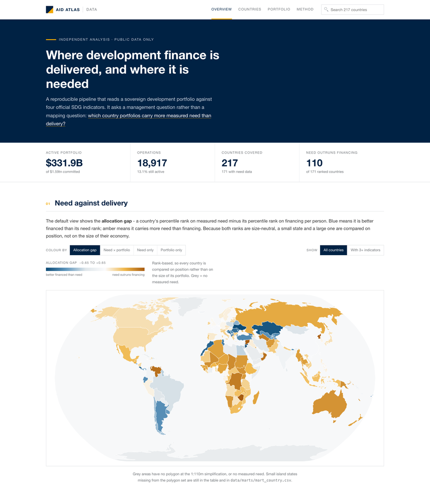
</p>

<p align="center"><em>One HTML file, no server, no build step. Every figure below is a screenshot of
<code>site/index.html</code> rendered from the committed snapshots.</em></p>

---

## Contents

- [What it answers](#what-it-answers)
- [Reading the dashboard](#reading-the-dashboard)
- [Key findings](#key-findings)
- [Does the short list survive a different reading?](#does-the-short-list-survive-a-different-reading)
- [Is the picture moving?](#is-the-picture-moving)
- [The operating profile](#the-operating-profile)
- [A scenario, priced](#a-scenario-priced)
- [The same money, three rules](#the-same-money-three-rules)
- [How it works](#how-it-works)
- [Repository layout](#repository-layout)
- [Running it](#running-it)
- [Data quality](#data-quality)
- [Method, in one page](#method-in-one-page)
- [What this cannot tell you](#what-this-cannot-tell-you)
- [Data provenance](#data-provenance)
- [Licence](#licence)

---

## What it answers

Portfolio reviews usually begin with the money or with the need. Institutions hold both
datasets and rarely put them on one axis, which is why "under-served country" conversations
tend to stall on whose indicator is authoritative.

This repository asks one question — *which country portfolios carry more measured need than
financing?* — and answers it with:

| Output | Definition |
|---|---|
| `allocation_gap` | percentile rank of a country on need minus its percentile rank on financing per person |
| `mart_priority` | the 25 countries with the largest positive gap, with the columns that explain each entry |
| `mart_country` | the full analytic table, one row per country, both layers plus terciles |
| `mart_portfolio_performance` | the same book as an operating profile: status, approval cohort, duration band, concentration |
| `mart_reallocation` | one row per scenario share: the pool, who funds it, who receives it, and the per-person gain |
| `mart_robustness` | the short list under six readings, with each country's rank under each |
| `mart_convergence` | need in 2015 against the latest reading, with post-2015 money per person |
| `site/index.html` | the same result as a self-contained interactive page |

Both ranks are size-neutral, so a small island state and a large borrower are compared on
position, not on the size of their economy. That choice is what makes the ranking usable in a
review: it produces a short list that a team of five could actually work through.

## Reading the dashboard

The page opens with one drawing rather than one chart: **167 squares, one country each**, ordered
by its gap inside its own region, with an amber rule under every country on the short list.

<p align="center">
  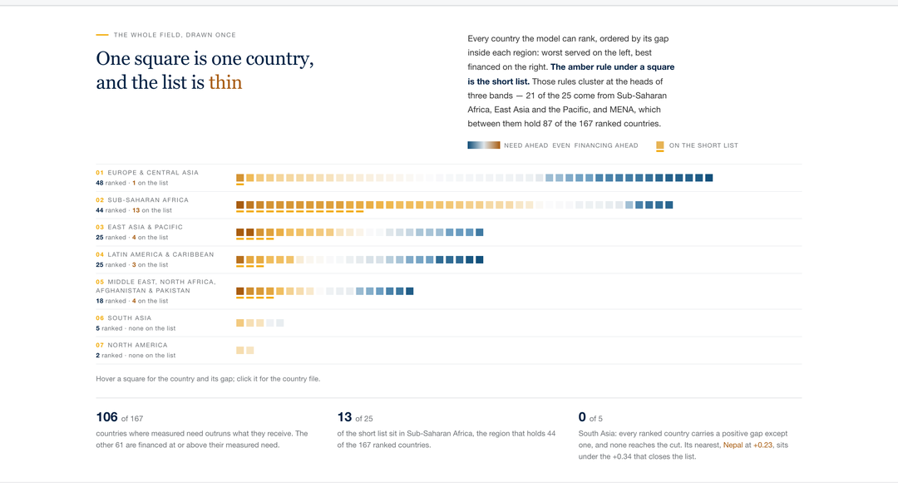
</p>

<p align="center"><em>The whole field. Bands are ordered by size, squares by allocation gap within
each band, colour by the gap itself. The amber rules give the short list a shape: 21 of the 25
sit in three bands, and South Asia's five ranked countries all fall under the cut.</em></p>

That drawing answers what a table answers badly — whether the list is a handful of countries or a
regional pattern, and where the field is simply financed ahead of its need. Everything after it
is the argument behind those squares.

Before the argument starts, the page stops generalising for three columns. Three countries on the
same list, read with the same ruler, turn out to be three different problems:

<p align="center">
  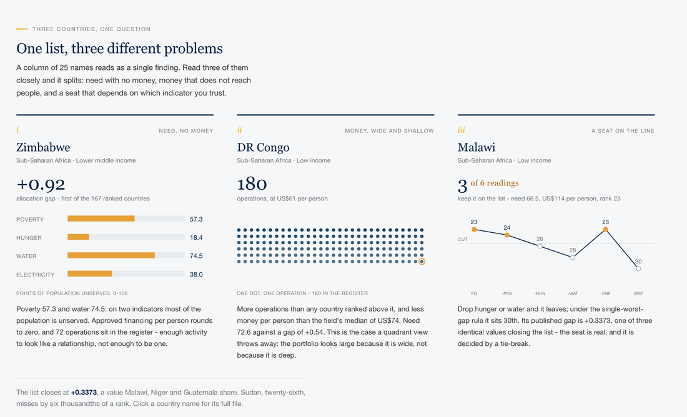
</p>

<p align="center"><em>One list, three different problems. Zimbabwe has need and no approved money;
DR Congo has 180 operations and less per person than the field's median; Malawi sits on the cut,
third of six readings. Each chart is built for its own question rather than borrowed from a chart
library.</em></p>

The third column is the one worth keeping: the list closes at **+0.3373**, a value Malawi, Niger
and Guatemala share, and Sudan at twenty-sixth misses by six thousandths of a rank. A short list
that ends in a tie is not fragile in principle - it is fragile in a specific, countable way, and
the footnote says so instead of hiding it. Country names in all three columns open their file.

The page is one file with no dependencies beyond a single CDN copy of D3, and it moves from
the map to the book without leaving the page. The default view colours each country by its
allocation gap and opens a country card on hover, so a portfolio question can be asked of the
map rather than of the table.

<p align="center">
  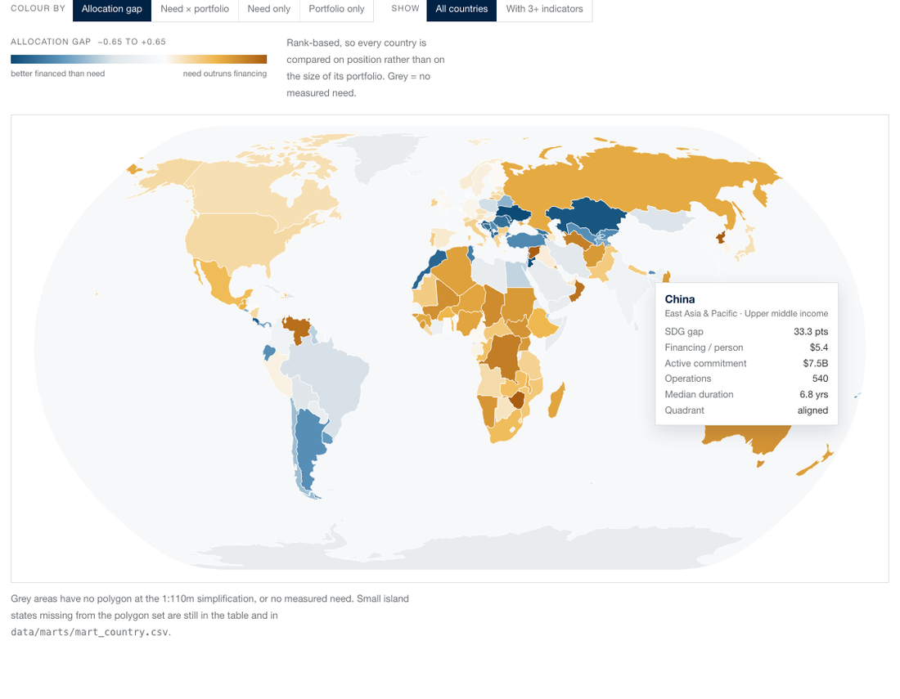
</p>

<p align="center"><em>Default view: blue is better financed than its measured need, amber is need
outrunning financing. The card carries the six numbers a reviewer would otherwise look up in
three files.</p>

Colour can be switched to the two components separately, or to the 3×3 quadrant grid, without
reloading the page:

<p align="center">
  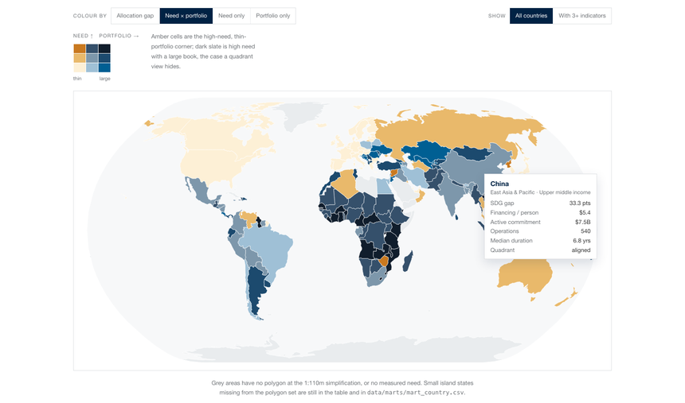
</p>

<p align="center"><em>Need × portfolio: the amber cells hold the population a quadrant view would
miss, countries with high need and a portfolio too large to be called thin.</em></p>

The country box in the header searches all 217 countries, not just the 25 on the short list.
A dropdown opens under it as you type, each entry carrying its allocation gap and a
`short list` tag where it applies:

<p align="center">
  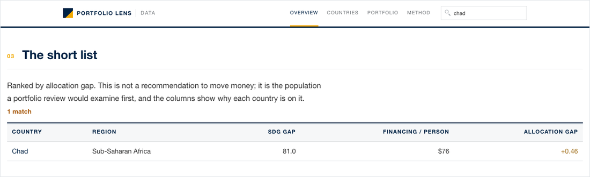
</p>

<p align="center"><em>Typing <code>congo</code>: two matches, the short-listed one tagged and both
carrying their allocation gap.</em></p>

Choosing an entry filters the table, scrolls to the row and highlights it; the count under the
paragraph heading keeps the filter legible rather than silent.

The page also has to work for a reader who does not spend their day in a spreadsheet — a
programme officer, a donor, a journalist. Five things carry that load:

- **Four stops at the top of the page.** A strip under the headline offers the map, the short
  list, the direction of travel and the method, so a first visit does not start with a menu.
- **A country file, not a tooltip.** Clicking a country on the map, a row of the short list, a
  row of the matrix, a dot in the drift panel or a name in the three-country columns opens a card
  with the four gaps as plain bars, the six numbers a reviewer would otherwise look up in three
  files, a one-sentence verdict, the country's rank under each of the six readings, and what
  changed since 2015.

<p align="center">
  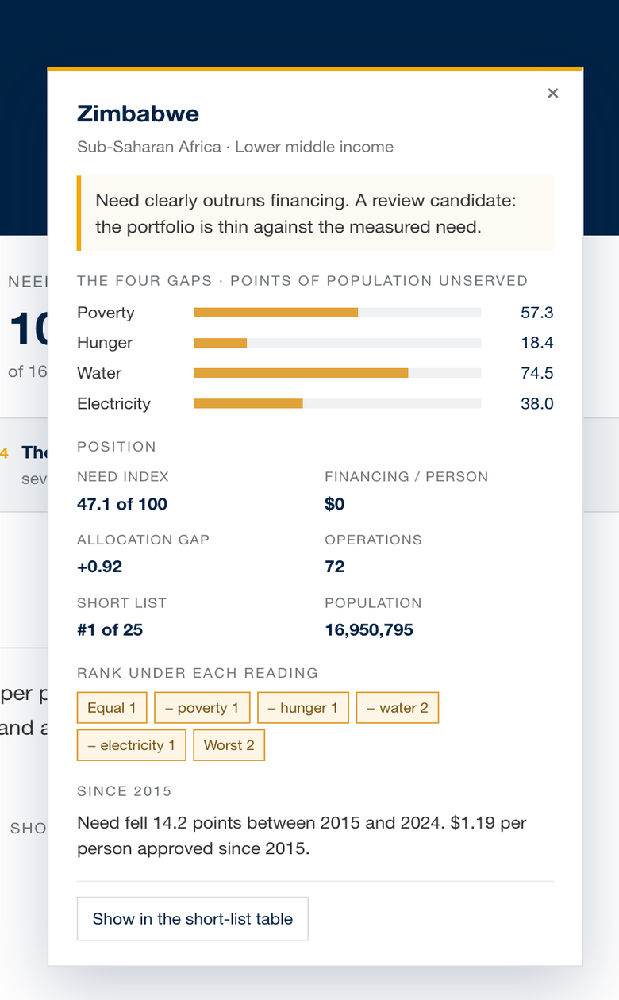
</p>

<p align="center"><em>Zimbabwe: need 47.1, no approved financing per person, gap +0.92, first on
the list under every reading. The verdict line is written for a reader who wants the point, not
the arithmetic.</em></p>

- **The matrix sorts itself.** Click a column header to re-rank all 25 under that reading, and
  the checkbox beside it drops countries that are not on the published list. Hovering a cell says
  where a country moves from, in places.
- **You set the weights.** Four sliders re-run the published ranking in the browser, using the
  same arithmetic as the SQL model: weighted mean of the gaps a country reports, percentile ranks
  on need and financing per person, then the difference. At equal weights the panel reproduces
  the published 25 exactly; setting water to zero drops the same six countries the matrix drops.

<p align="center">
  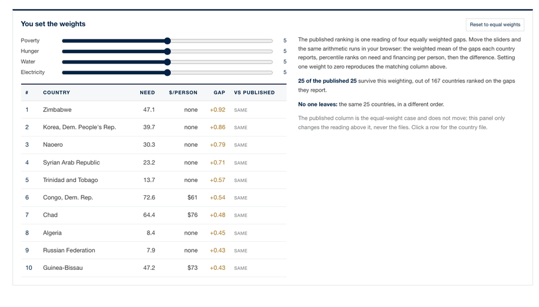
</p>

<p align="center"><em>Equal weights: 25 of 25 survive, in the same order. Every change is a
reading of the data, not a write to it — the CSVs stay as published.</em></p>

- **Seven terms, in plain words.** A short glossary closes the method section: need index,
  financing per person, percentile rank, allocation gap, short list, reading, stakeholder view.

Five further elements carry the rest of the analysis: a scatter of need against financing per
person with the review corner shaded, the robustness matrix that reruns the short list six ways,
a drift panel that puts the change in need since 2015 against where each country started, a
sector table with shares of classified value, and a regional table. The scatter and the drift
panel are live: hovering a point opens the country card, and clicking it carries the country into
the short-list table. All of them read from the same embedded payload, so the page and the CSVs in
`data/marts/` cannot disagree.

## Key findings

Portfolio: **18,917 operations, US$1.59tn committed, US$331.9bn active** across 217 countries.
20.8% of committed value is still live; the median operation runs 5.9 years.

- **106 of 167 countries with measured need carry a positive allocation gap** — more need
  than financing, once both are expressed as ranks.
- **The strongest case is a country that a quadrant view rejects.** The Democratic Republic of
  Congo ranks sixth on the gap (need 72.6 of 100, US$61 per person, gap +0.54) yet holds 180
  operations. It sits in the "aligned" cell of a hard 3×3 because its portfolio tercile is not
  the bottom one. Chad is the same shape at a smaller scale: need 64.4, US$76 per person,
  100 operations, gap +0.48. Both are portfolio-review candidates, not funding gaps.
- **The top of the list is not the same population as the biggest borrowers.** Zimbabwe
  (gap +0.92) and DPR Korea (+0.86) lead on need with no active operations at all, while
  large portfolios such as India and Brazil sit near the middle. Absolute commitment and
  per-capita financing rank countries differently, and only the second answers the question.
- **Sector concentration is moderate**: Herfindahl index 0.120 on classified value, led by
  public administration (17.9%), transport (14.3%), energy and extractives (14.0%) and
  finance and the private sector (12.7%). Health is 5.6%, water and sanitation 8.1%,
  environment and climate 0.5%.
- **The book is slow-moving**: only 13.1% of operations are active, and 4.6% have a planned
  duration over ten years.

## Does the short list survive a different reading?

The ranking weights four gaps equally. That is a choice, not a fact, so the model reruns it six
ways — dropping each indicator in turn, and once under a single-worst-indicator rule — and
publishes all six rankings as `mart_robustness`:

<p align="center">
  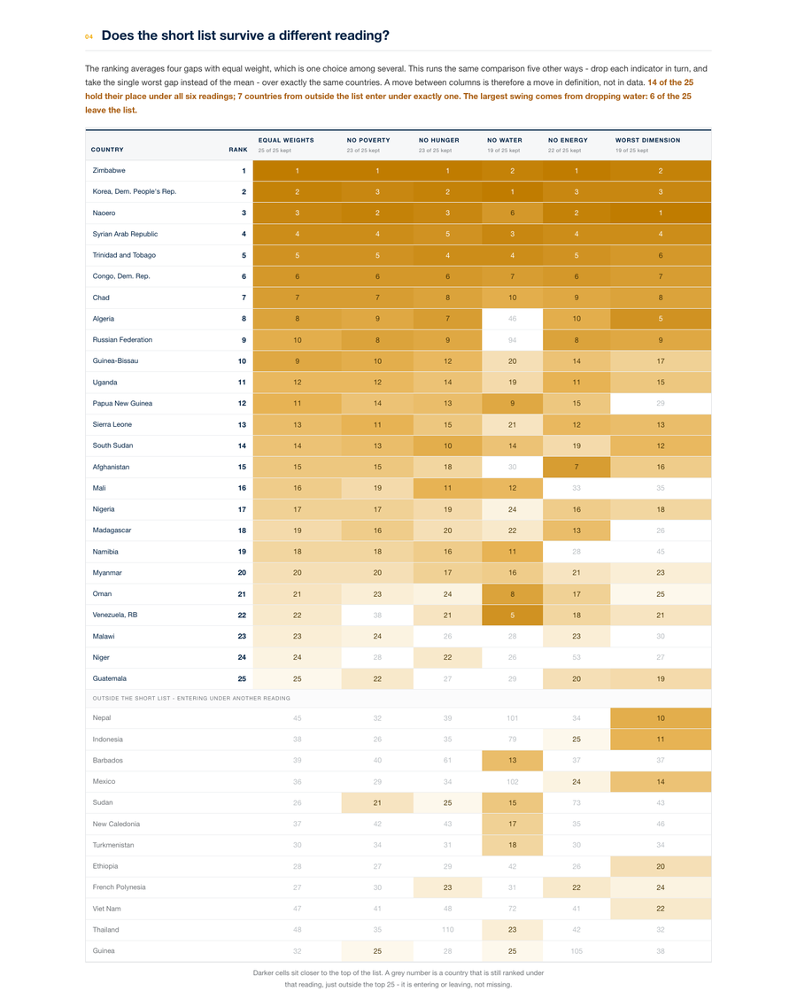
</p>

- **14 of the 25 hold their place under all six readings.** The centre of the list is a property
  of the data, not of the weighting.
- **Water does most of the work.** Drop the drinking-water gap and six countries leave the list,
  because their water coverage is high enough to carry the other three. Russia falls 85 places,
  Algeria 38.
- **Two entries are fragile.** Malawi holds in three readings, Niger in two; drop the water gap
  and both leave, drop electricity and Niger leaves as well. Rank carries the evidence: Niger
  sits 53rd when the electricity gap is removed, from 24th on the published ranking.
- **Twelve countries outside the list are one reading away.** Sudan enters under three readings
  (15th without water), Nepal is 10th on the worst dimension, Thailand 23rd without water. A
  single-indicator reading is a different review, not a variant of the same one.

## Is the picture moving?

A gap is only actionable if it is closing or stuck. `mart_convergence` reads each country's need
index in 2015 and again in its latest reporting year (2021–2024, which differs by country), and
puts the change against the starting point:

<p align="center">
  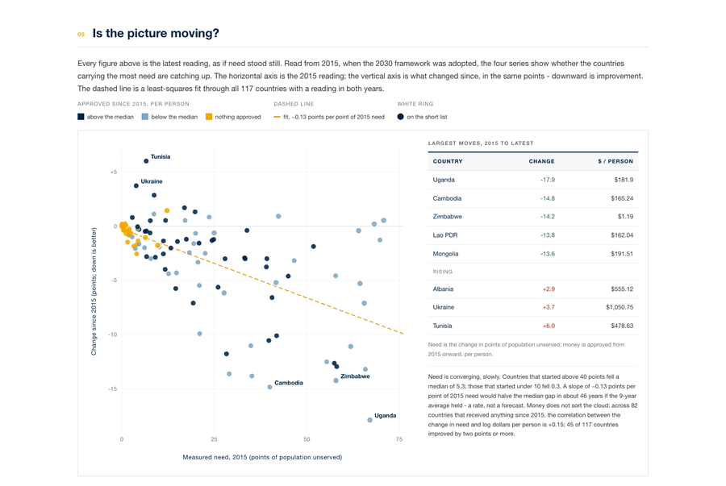
</p>

- **The index is converging, slowly.** 117 countries carry both readings: the median country fell
  1.3 points and 45 fell by two or more, against three that rose. A fitted line of −0.13 points
  per point of 2015 need means the countries that started worst improved most — those above 40
  fell 5.3 points at the median, those below 10 barely moved (−0.3).
- **At that slope, half the distance closes in about 46 years.** Inside a working career, well
  outside the 2030 horizon the four indicators were chosen for.
- **Money and progress are only loosely related.** Across the 82 countries that received
  post-2015 commitments, the correlation between the change and financing per person is +0.15 —
  barely visible. Zimbabwe cut its index 14.2 points on US$1.19 per person; Ukraine, at
  US$1,051 per person, went the other way at +3.7.
- **This is a two-point reading, not a trend.** The endpoint years differ by country and the
  series are revised, which is why the page prints the window rather than a rate per year.

## The operating profile

The map answers *where*. A portfolio review also has to answer *what state the book is in*, and
that question is organisational rather than geographic: how much value is still live, how old
the live work is, how long operations are planned to run, and whether a handful of operations
carry the book.

<p align="center">
  
</p>

- **One fifth of committed value is live.** Active 20.8%, closed 59.7%, pipeline 9.8%, dropped
  9.7%. Pipeline and dropped together are 19.5% of value — the queue that a review inherits
  rather than creates.
- **The live book is young; the closed book is not.** The 2020s approval cohort holds 19.9% of
  value and is 79% still active. The 2010s cohort holds 20.5% and is 24% still active. Value
  approved before 2000 is fully closed.
- **Planned duration clusters in the middle.** 43.4% of value sits in 5–10 year operations,
  4.1% above ten years, and 24.6% carries no usable dates — reported as its own bucket, not
  imputed.
- **Concentration is low.** The largest single operation is 5.7% of value, the top ten 7.5%,
  the top fifty 11.1%. No single project can move the portfolio, which is what makes a
  programmatic review feasible.

## A scenario, priced

The natural follow-up question — *what would moving money actually buy?* — is answered with one
number rather than an adjective. Five per cent of live value is $16.6bn; raised pro rata from the
58 countries with a negative gap and a live portfolio, and paid pro rata to population across
the 25 short-listed countries:

| Quantity | Value |
|---|---|
| Value moved | $16.6bn (5.0% of $331.9bn live) |
| Gain per person, 25 recipient countries | $16.92 |
| Cost per person, 58 contributing countries | $6.95 |
| People covered | 981m |

The slider on the page recomputes the pool at 1–10% with the same formula, so the arithmetic is
auditable rather than asserted. The one-page business case — assumptions, what the number does
not buy, and what evidence would falsify it — is in
[`docs/reallocation-case.md`](docs/reallocation-case.md). It is a demonstration on a public
snapshot, not a recommendation.

## The same money, three rules

The scenario above answers *how much*. The page closes with a harder question: *by what rule?*
Take the same pool and split it three defensible ways — by population, by need, by gap — and
watch which of the 25 names gets served. Every bar is dollars per person; each strip is scaled to
its own tallest bar and printed with how many times the field median of $74 sits above it:

<p align="center">
  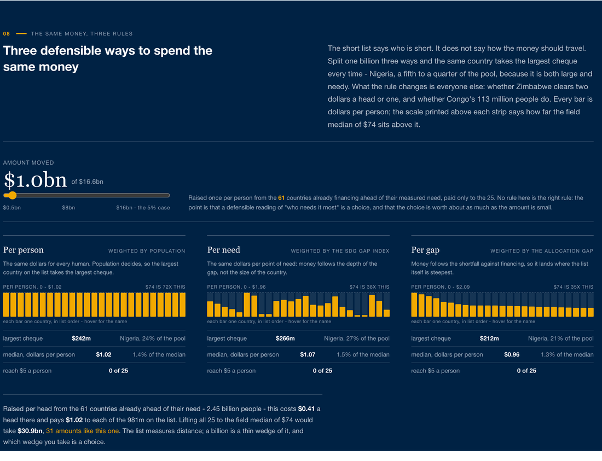
</p>

<p align="center"><em>Three rules at US$1bn. The strips are normalised to their own maximum and
labelled with how many times the field median towers above them.</em></p>

Three things come out of moving the slider, and none of them is the one the framing invites:

- **The largest cheque goes to the same country under every rule.** Nigeria takes 21–27% of any
  billion, because it is both large and needy. A "who wins" contest that changes the largest
  winner is a contest between populations, not between rules.
- **What the rule changes is the tail.** Paid per person, all 25 get $1.02 and nobody reaches $5.
  Paid by gap, Zimbabwe reaches $2.09 and Malawi $0.77; paid by need, Congo reaches $1.96 and
  Malawi $1.80. At the full 5% case (US$16.6bn) need-weighting fills 21 of the 25 to $5 a head —
  and still nobody reaches the $74 median.
- **The distance is the finding.** Lifting all 25 to the field median would take $30.9bn, about
  31 billions like the default one. Reallocation at the margin is real, and it is an order of
  magnitude smaller than the gap it is meant to close.

The band is drawn in the browser from the same embedded payload; nothing in it is a hard-coded
figure. It is the last section of the argument, and the one a stakeholder can argue with.

## How it works

<p align="center">
  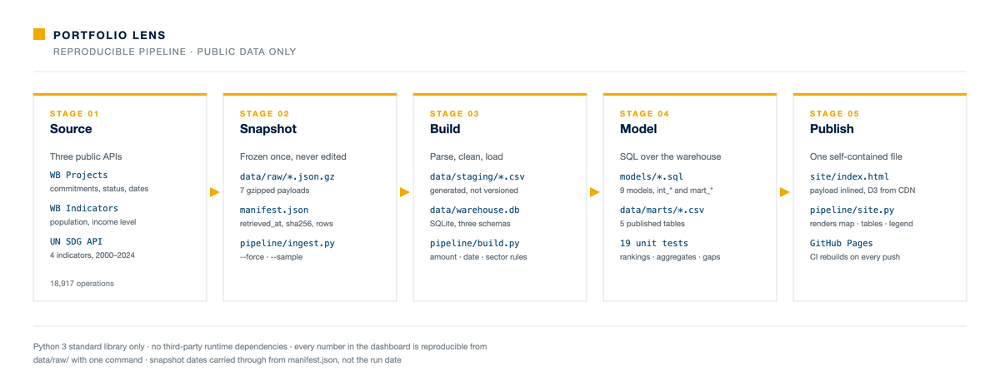
</p>

1. **Source** is public data only: the sovereign project register, four SDG indicators, and
   the population and income fields that make them readable per person. No figure depends on a
   private feed.
2. **Snapshot.** Each download is checksummed into `data/raw/` and recorded in a manifest, so
   every downstream number can be reproduced without touching the network again.
3. **Build** flattens the project register: one row per operation, one row per
   operation–country link, with commitments split evenly across recipients. These staging CSVs
   are generated on every build and are not versioned.
4. **Model.** Plain SQL files run in filename order. Intermediates are `int_*`, published tables
   are `mart_*`; nothing in a mart reads a CSV directly. Fifteen models produce nine published
   tables.
5. **Publish.** `pipeline/dq.py` runs 14 assertions over the warehouse and the marts and writes
   `mart_dq.csv`; the renderer reads that file, and a failing check stops the build before a
   page is written. The site then embeds the marts and the country geometry into one HTML file.
   Only D3 is fetched from a CDN; there is no runtime API call.

The same five stages, with the same names, are printed on the page in section 08, so a reader of
the dashboard does not have to leave it to find out where the numbers came from.

The pipeline is standard library only. No pandas, no ORM, no third-party runtime dependency —
a reviewer can read every line that produces a number.

## Repository layout

```
pipeline/
  ingest.py          snapshot fetchers, retry policy, manifest
  build.py           staging, warehouse load, SQL runner, mart export
  dq.py              the data-quality gate; writes mart_dq.csv, exits 1 on a failure
  site.py            payload assembly and HTML render
models/
  10_int_country_portfolio.sql
  11_int_country_duration.sql
  12_int_country_need.sql
  20_mart_country.sql
  21_mart_sector.sql
  22_mart_region.sql
  23_mart_portfolio_health.sql
  24_mart_portfolio_performance.sql  status, cohort, duration, concentration
  25_mart_country_gap.sql      percentile ranks, allocation gap
  26_mart_priority.sql         the short list
  27_mart_reallocation.sql     one scenario row: pool, donors, recipients, per-person figures
  28_int_country_need_history.sql  need by country and year, deduplicated and clamped
  29_int_country_post2015.sql      commitments from 2015, per country
  30_mart_convergence.sql      2015 against the latest reading, with money per person
  31_mart_robustness.sql       the short list under six readings, with rank movement
docs/
  methodology.md      every decision that changes a number
  data_dictionary.md  column-level contract for each table
  sector_taxonomy.md  the 12-group mapping and why it is a rule table
  data_quality.md     the 14 checks, their thresholds, and what a failure means
  reallocation-case.md  the five per cent scenario as a one-page business case
  decisions/          ADRs for the choices that had alternatives
  img/                screenshots of the page, and the pipeline diagram with its HTML source
sops/
  refresh-data.md     quarterly refresh, step by step
  add-an-indicator.md extending the need index
  review-a-portfolio.md  how the output is used in a review
tests/test_pipeline.py   48 tests: reconciliation, bounds, ranking, robustness of the ranking,
                         drift arithmetic, operating profile, scenario arithmetic, the
                         quality gate and page structure
data/
  raw/                committed snapshots and their manifest
  staging/            generated by build.py, git-ignored
  marts/              the nine published marts, plus mart_dq.csv from the gate
  warehouse/          SQLite file, generated, git-ignored
site/index.html          rendered output
```

What is committed is what cannot be rebuilt cheaply: the source snapshots, the SQL, the
published marts and the rendered page. Everything between the snapshots and the marts is
reproducible from `pipeline/build.py` in a few seconds and stays out of the repository.

## Running it

```bash
python pipeline/ingest.py          # fetch snapshots (≈2 min, needs network)
python pipeline/build.py           # staging → warehouse → marts
python pipeline/dq.py              # 14 checks; non-zero exit stops the build
python pipeline/site.py            # render site/index.html
python -m unittest discover -s tests
```

or, with the same steps behind one target:

```bash
make all                           # build → dq → site → test
```

`ingest.py --sample` pulls a small slice for a fast end-to-end run; `--force` refetches
everything. The committed `data/raw/` tree is the product of a full run, so `build.py` and
`site.py` alone reproduce the published figures offline. `make test` depends on `make dq`,
which depends on `make build`: the tests read the staging tables the build generates and the
quality table the gate writes.

## Data quality

<p align="center">
  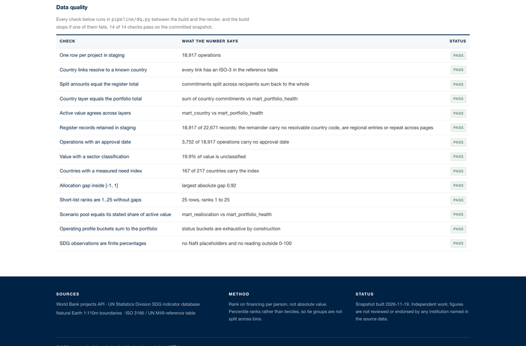
</p>

Fourteen checks run between the build and the render, and the page prints their result rather
than inviting the reader to trust the pipeline. They fall into five kinds:

- **Integrity** — one row per project, every country link resolving to a known ISO-3.
- **Reconciliation** — split commitments summing back to the register total, the country layer
  agreeing with the portfolio total to within 0.5%, and the operating buckets partitioning the
  book.
- **Coverage and completeness floors** — 83.4% of register records retained, 80.2% of operations
  with an approval date, 80.1% of value classified, 167 countries with a need index.
- **Bounds** — the allocation gap staying inside its construction range.
- **Scenario consistency** — the pool equalling its stated share of live value, so the slider
  and the static text cannot drift apart.

Floors sit below the observed value on purpose (83.4% against a 75% floor), so a real
regression trips the gate while ordinary snapshot-to-snapshot variance does not. Every threshold
and its reasoning is in [`docs/data_quality.md`](docs/data_quality.md); a failure names the two
layers being compared and stops CI before the page is regenerated.

## Method, in one page

**Delivery layer.** World Bank project register, parsed into country links. Commitments are
split evenly where an operation covers several countries; planned duration runs from board
approval to closing date. Active means the register's status field starts with `Active`.

**Need layer.** Four SDG series chosen because each carries a stated 2030 target of 0% or 100%,
so no threshold has to be invented: poverty (1.1.1), undernourishment (2.1.1), safely managed
drinking water (6.1.1), electricity access (7.1.1). Each becomes percentage points of population
not yet served; the index is their unweighted mean. A country enters the ranking only with
three of the four, so a data-poor state is never silently classified as low-need.

**Bridging.** The three sources key on ISO-2, ISO-3 and UN M49, so a single reference table is
the join key and the only place country identity is defined. Legacy register codes (`ZR`, `RY`,
`GZ`, `TP`) are mapped to their successors and resolved explicitly, including the 4,487
operations that would otherwise drop out.

**Boundaries.** The portfolio keys on sovereign borrowers, and the map is keyed the same way:
the 1:110m geometry is attached to the sovereign unit that the register uses, so the map draws
one China, with Taiwan inside the China feature. Territories that are not separate borrowers
are recorded during the build rather than dropped silently.

**Ranking.** Percentile ranks rather than terciles: dozens of countries tie at zero financing,
and a binning method that splits tie groups would label an unfunded country "middle". The
detail, and the alternatives rejected, is in `docs/decisions/`.

**Operating profile.** The same operations read four ways — status, approval cohort, planned
duration band, concentration — with each dimension partitioning the book, so the shares add to
one and every operation lands in exactly one bucket. Unclassified cases (no status, no approval
date, no usable duration) are their own bucket rather than an imputed middle.

**Scenario.** The pool is a share of active commitment, raised pro rata from countries with a
negative allocation gap and a live portfolio, and paid pro rata to population across the 25
short-listed countries. Gains per person are therefore identical by construction, which is
stated as a property of the formula rather than presented as a finding. Commitment is the base,
not disbursement, because the register does not publish disbursement.

## What this cannot tell you

1. **Commitment is not disbursement.** Value here is approved financing, not money that reached
   a country.
2. **It does not attribute outcomes.** A thin portfolio and a large gap can both be symptoms of
   state capacity, access constraints or a division of labour between financiers.
3. **Percentiles are relative, not sufficiency standards.** A country can rank badly while
   receiving more per person in absolute terms than its neighbours.
4. **Polygon coverage.** Natural Earth at 1:110m draws 177 polygons; small island states are in
   the tables and absent from the map.
5. **Two clocks.** Portfolio data is administrative and revised continuously; SDG series are
   statistical and lag by years. The join is a snapshot, not a time series.
6. **The scenario is arithmetic, not advice.** It moves commitment, not disbursements, and it
   is silent on absorption capacity — a country that cannot spend its current portfolio will not
   spend a larger one faster.

## Data provenance

| Source | Used for | Licence |
|---|---|---|
| World Bank Projects API | portfolio, country metadata, population | CC BY 4.0 |
| UN SDG Indicators API | need index | CC BY 4.0 |
| UN M49 / `datasets/country-codes` | country identity table | Public domain |
| Natural Earth 1:110m | geometry | Public domain |

This is an independent analysis of public data. It is not affiliated with, endorsed by, or
produced for any institution named in the sources, and no institutional logo or name is used.

## Licence

MIT. See `LICENSE`.
