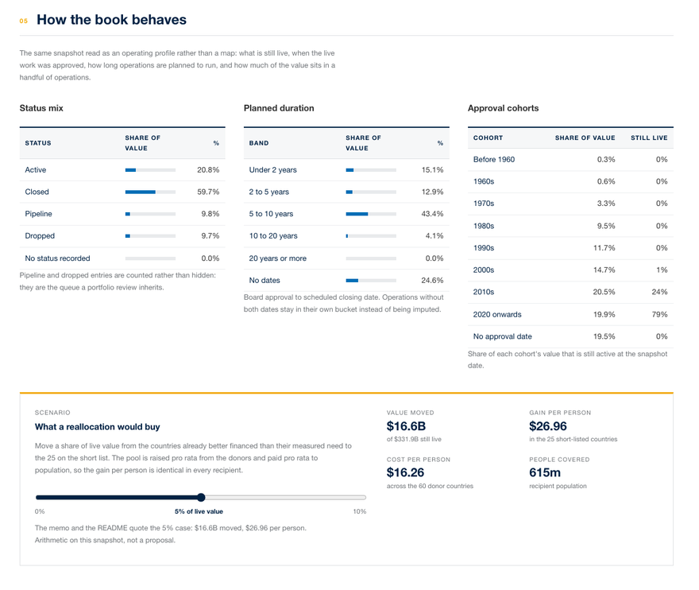

# Aid Atlas

**Where development finance is delivered, and where it is needed.**

[](https://www.python.org/)
[](https://sqlite.org/)
[](#running-it)
[](#running-it)
[](https://github.com/caoqyqianyi/aid-atlas/actions/workflows/ci.yml)
[](LICENSE)

A reproducible pipeline that places a sovereign development portfolio on the same axis as
measured service need, and ranks the 171 countries where both exist and the two diverge. It is built as a
management instrument — a defensible review population for portfolio performance work —
rather than as a map, and the geospatial layer is a reading aid, not the answer.

**Live dashboard:** [caoqyqianyi.github.io/aid-atlas](https://caoqyqianyi.github.io/aid-atlas/)

<p align="center">
  
</p>

<p align="center"><em>One HTML file, no server, no build step. Every figure below is a screenshot of
<code>site/index.html</code> rendered from the committed snapshots.</em></p>

---

## Contents

- [What it answers](#what-it-answers)
- [Reading the dashboard](#reading-the-dashboard)
- [Key findings](#key-findings)
- [The operating profile](#the-operating-profile)
- [A scenario, priced](#a-scenario-priced)
- [How it works](#how-it-works)
- [Repository layout](#repository-layout)
- [Running it](#running-it)
- [Data quality](#data-quality)
- [Method, in one page](#method-in-one-page)
- [What this cannot tell you](#what-this-cannot-tell-you)
- [Data provenance](#data-provenance)
- [Licence](#licence)

---

## What it answers

Portfolio reviews usually begin with the money or with the need. Institutions hold both
datasets and rarely put them on one axis, which is why "under-served country" conversations
tend to stall on whose indicator is authoritative.

This repository asks one question — *which country portfolios carry more measured need than
financing?* — and answers it with:

| Output | Definition |
|---|---|
| `allocation_gap` | percentile rank of a country on need minus its percentile rank on financing per person |
| `mart_priority` | the 25 countries with the largest positive gap, with the columns that explain each entry |
| `mart_country` | the full analytic table, one row per country, both layers plus terciles |
| `mart_portfolio_performance` | the same book as an operating profile: status, approval cohort, duration band, concentration |
| `mart_reallocation` | one row per scenario share: the pool, who funds it, who receives it, and the per-person gain |
| `site/index.html` | the same result as a self-contained interactive page |

Both ranks are size-neutral, so a small island state and a large borrower are compared on
position, not on the size of their economy. That choice is what makes the ranking usable in a
review: it produces a short list that a team of five could actually work through.

## Reading the dashboard

The page is one file with no dependencies beyond a single CDN copy of D3, and it moves from
the map to the book without leaving the page. The default view colours each country by its
allocation gap and opens a country card on hover, so a portfolio question can be asked of the
map rather than of the table.

<p align="center">
  
</p>

<p align="center"><em>Default view: blue is better financed than its measured need, amber is need
outrunning financing. The card carries the six numbers a reviewer would otherwise look up in
three files.</p>

Colour can be switched to the two components separately, or to the 3×3 quadrant grid, without
reloading the page:

<p align="center">
  
</p>

<p align="center"><em>Need × portfolio: the amber cells hold the population a quadrant view would
miss, countries with high need and a portfolio too large to be called thin.</em></p>

The country box in the header searches all 217 countries, not just the 25 on the short list.
A dropdown opens under it as you type, each entry carrying its allocation gap and a
`short list` tag where it applies:

<p align="center">
  
</p>

<p align="center"><em>Typing <code>congo</code>: two matches, the short-listed one tagged and both
carrying their allocation gap.</em></p>

Choosing an entry filters the table, scrolls to the row and highlights it; the count under the
paragraph heading keeps the filter legible rather than silent.

Three further elements carry the rest of the analysis: a scatter of need against financing per
person with the review corner shaded, a sector table with shares of classified value, and a
regional table. The scatter is interactive: hovering a point opens a country card with need, financing per
person, allocation gap and operations, and clicking it highlights that country in the short
list. All of them read from the same embedded payload, so the page and the CSVs in
`data/marts/` cannot disagree.

## Key findings

Portfolio: **18,917 operations, US$1.59tn committed, US$331.9bn active** across 217 countries.
20.8% of committed value is still live; the median operation runs 5.9 years.

- **110 of 171 countries with measured need carry a positive allocation gap** — more need
  than financing, once both are expressed as ranks.
- **The strongest case is a country that a quadrant view rejects.** The Democratic Republic of
  Congo ranks 8th on the gap (need 87.7 of 100, US$61 per person, gap +0.52) yet holds 180
  operations. It sits in the "aligned" cell of a hard 3×3 because its portfolio tercile is not
  the bottom one. Chad is the same shape at a smaller scale: need 81.0, US$76 per person,
  100 operations, gap +0.46. Both are portfolio-review candidates, not funding gaps.
- **The top of the list is not the same population as the biggest borrowers.** Zimbabwe
  (gap +0.92) and DPR Korea (+0.84) lead on need with no active operations at all, while
  large portfolios such as India and Brazil sit near the middle. Absolute commitment and
  per-capita financing rank countries differently, and only the second answers the question.
- **Sector concentration is moderate**: Herfindahl index 0.120 on classified value, led by
  public administration (17.9%), transport (14.3%), energy and extractives (14.0%) and
  finance and the private sector (12.7%). Health is 5.6%, water and sanitation 8.1%,
  environment and climate 0.5%.
- **The book is slow-moving**: only 13.1% of operations are active, and 4.6% have a planned
  duration over ten years.

## The operating profile

The map answers *where*. A portfolio review also has to answer *what state the book is in*, and
that question is organisational rather than geographic: how much value is still live, how old
the live work is, how long operations are planned to run, and whether a handful of operations
carry the book.

<p align="center">
  
</p>

- **One fifth of committed value is live.** Active 20.8%, closed 59.7%, pipeline 9.8%, dropped
  9.7%. Pipeline and dropped together are 19.5% of value — the queue that a review inherits
  rather than creates.
- **The live book is young; the closed book is not.** The 2020s approval cohort holds 19.9% of
  value and is 79% still active. The 2010s cohort holds 20.5% and is 24% still active. Value
  approved before 2000 is fully closed.
- **Planned duration clusters in the middle.** 43.4% of value sits in 5–10 year operations,
  4.1% above ten years, and 24.6% carries no usable dates — reported as its own bucket, not
  imputed.
- **Concentration is low.** The largest single operation is 5.7% of value, the top ten 7.5%,
  the top fifty 11.1%. No single project can move the portfolio, which is what makes a
  programmatic review feasible.

## A scenario, priced

The natural follow-up question — *what would moving money actually buy?* — is answered with one
number rather than an adjective. Five per cent of live value is $16.6bn; raised pro rata from the
60 countries with a negative gap and a live portfolio, and paid pro rata to population across
the 25 short-listed countries:

| Quantity | Value |
|---|---|
| Value moved | $16.6bn (5.0% of $331.9bn live) |
| Gain per person, 25 recipient countries | $26.96 |
| Cost per person, 60 contributing countries | $16.26 |
| People covered | 615m |

The slider on the page recomputes the pool at 1–10% with the same formula, so the arithmetic is
auditable rather than asserted. The one-page business case — assumptions, what the number does
not buy, and what evidence would falsify it — is in
[`docs/reallocation-case.md`](docs/reallocation-case.md). It is a demonstration on a public
snapshot, not a recommendation.

## How it works

<p align="center">
  
</p>

1. **Source** is public data only: the sovereign project register, four SDG indicators, and
   the population and income fields that make them readable per person. No figure depends on a
   private feed.
2. **Snapshot.** Each download is checksummed into `data/raw/` and recorded in a manifest, so
   every downstream number can be reproduced without touching the network again.
3. **Build** flattens the project register: one row per operation, one row per
   operation–country link, with commitments split evenly across recipients. These staging CSVs
   are generated on every build and are not versioned.
4. **Model.** Plain SQL files run in filename order. Intermediates are `int_*`, published tables
   are `mart_*`; nothing in a mart reads a CSV directly. Eleven models produce seven published
   tables.
5. **Publish.** `pipeline/dq.py` runs 13 assertions over the warehouse and the marts and writes
   `mart_dq.csv`; the renderer reads that file, and a failing check stops the build before a
   page is written. The site then embeds the marts and the country geometry into one HTML file.
   Only D3 is fetched from a CDN; there is no runtime API call.

The same five stages, with the same names, are printed on the page in section 06, so a reader of
the dashboard does not have to leave it to find out where the numbers came from.

The pipeline is standard library only. No pandas, no ORM, no third-party runtime dependency —
a reviewer can read every line that produces a number.

## Repository layout

```
pipeline/
  ingest.py          snapshot fetchers, retry policy, manifest
  build.py           staging, warehouse load, SQL runner, mart export
  dq.py              the data-quality gate; writes mart_dq.csv, exits 1 on a failure
  site.py            payload assembly and HTML render
models/
  10_int_country_portfolio.sql
  11_int_country_duration.sql
  12_int_country_need.sql
  20_mart_country.sql
  21_mart_sector.sql
  22_mart_region.sql
  23_mart_portfolio_health.sql
  24_mart_portfolio_performance.sql  status, cohort, duration, concentration
  25_mart_country_gap.sql      percentile ranks, allocation gap
  26_mart_priority.sql         the short list
  27_mart_reallocation.sql     one scenario row: pool, donors, recipients, per-person figures
docs/
  methodology.md      every decision that changes a number
  data_dictionary.md  column-level contract for each table
  sector_taxonomy.md  the 12-group mapping and why it is a rule table
  data_quality.md     the 13 checks, their thresholds, and what a failure means
  reallocation-case.md  the five per cent scenario as a one-page business case
  decisions/          ADRs for the choices that had alternatives
  img/                screenshots of the page, and the pipeline diagram with its HTML source
sops/
  refresh-data.md     quarterly refresh, step by step
  add-an-indicator.md extending the need index
  review-a-portfolio.md  how the output is used in a review
tests/test_pipeline.py   34 tests: reconciliation, bounds, ranking, operating profile,
                         scenario arithmetic, the quality gate and page structure
data/
  raw/                committed snapshots and their manifest
  staging/            generated by build.py, git-ignored
  marts/              the seven published marts, plus mart_dq.csv from the gate
  warehouse/          SQLite file, generated, git-ignored
site/index.html          rendered output
```

What is committed is what cannot be rebuilt cheaply: the source snapshots, the SQL, the
published marts and the rendered page. Everything between the snapshots and the marts is
reproducible from `pipeline/build.py` in a few seconds and stays out of the repository.

## Running it

```bash
python pipeline/ingest.py          # fetch snapshots (≈2 min, needs network)
python pipeline/build.py           # staging → warehouse → marts
python pipeline/dq.py              # 13 checks; non-zero exit stops the build
python pipeline/site.py            # render site/index.html
python -m unittest discover -s tests
```

or, with the same steps behind one target:

```bash
make all                           # build → dq → site → test
```

`ingest.py --sample` pulls a small slice for a fast end-to-end run; `--force` refetches
everything. The committed `data/raw/` tree is the product of a full run, so `build.py` and
`site.py` alone reproduce the published figures offline. `make test` depends on `make dq`,
which depends on `make build`: the tests read the staging tables the build generates and the
quality table the gate writes.

## Data quality

<p align="center">
  
</p>

Thirteen checks run between the build and the render, and the page prints their result rather
than inviting the reader to trust the pipeline. They fall into five kinds:

- **Integrity** — one row per project, every country link resolving to a known ISO-3.
- **Reconciliation** — split commitments summing back to the register total, the country layer
  agreeing with the portfolio total to within 0.5%, and the operating buckets partitioning the
  book.
- **Coverage and completeness floors** — 83.4% of register records retained, 80.2% of operations
  with an approval date, 80.1% of value classified, 171 countries with a need index.
- **Bounds** — the allocation gap staying inside its construction range.
- **Scenario consistency** — the pool equalling its stated share of live value, so the slider
  and the static text cannot drift apart.

Floors sit below the observed value on purpose (83.4% against a 75% floor), so a real
regression trips the gate while ordinary snapshot-to-snapshot variance does not. Every threshold
and its reasoning is in [`docs/data_quality.md`](docs/data_quality.md); a failure names the two
layers being compared and stops CI before the page is regenerated.

## Method, in one page

**Delivery layer.** World Bank project register, parsed into country links. Commitments are
split evenly where an operation covers several countries; planned duration runs from board
approval to closing date. Active means the register's status field starts with `Active`.

**Need layer.** Four SDG series chosen because each carries a stated 2030 target of 0% or 100%,
so no threshold has to be invented: poverty (1.1.1), undernourishment (2.1.1), safely managed
drinking water (6.1.1), electricity access (7.1.1). Each becomes percentage points of population
not yet served; the index is their unweighted mean. A country enters the ranking only with
three of the four, so a data-poor state is never silently classified as low-need.

**Bridging.** The three sources key on ISO-2, ISO-3 and UN M49, so a single reference table is
the join key and the only place country identity is defined. Legacy register codes (`ZR`, `RY`,
`GZ`, `TP`) are mapped to their successors and resolved explicitly, including the 4,487
operations that would otherwise drop out.

**Boundaries.** The portfolio keys on sovereign borrowers, and the map is keyed the same way:
the 1:110m geometry is attached to the sovereign unit that the register uses, so the map draws
one China, with Taiwan inside the China feature. Territories that are not separate borrowers
are recorded during the build rather than dropped silently.

**Ranking.** Percentile ranks rather than terciles: dozens of countries tie at zero financing,
and a binning method that splits tie groups would label an unfunded country "middle". The
detail, and the alternatives rejected, is in `docs/decisions/`.

**Operating profile.** The same operations read four ways — status, approval cohort, planned
duration band, concentration — with each dimension partitioning the book, so the shares add to
one and every operation lands in exactly one bucket. Unclassified cases (no status, no approval
date, no usable duration) are their own bucket rather than an imputed middle.

**Scenario.** The pool is a share of active commitment, raised pro rata from countries with a
negative allocation gap and a live portfolio, and paid pro rata to population across the 25
short-listed countries. Gains per person are therefore identical by construction, which is
stated as a property of the formula rather than presented as a finding. Commitment is the base,
not disbursement, because the register does not publish disbursement.

## What this cannot tell you

1. **Commitment is not disbursement.** Value here is approved financing, not money that reached
   a country.
2. **It does not attribute outcomes.** A thin portfolio and a large gap can both be symptoms of
   state capacity, access constraints or a division of labour between financiers.
3. **Percentiles are relative, not sufficiency standards.** A country can rank badly while
   receiving more per person in absolute terms than its neighbours.
4. **Polygon coverage.** Natural Earth at 1:110m draws 177 polygons; small island states are in
   the tables and absent from the map.
5. **Two clocks.** Portfolio data is administrative and revised continuously; SDG series are
   statistical and lag by years. The join is a snapshot, not a time series.
6. **The scenario is arithmetic, not advice.** It moves commitment, not disbursements, and it
   is silent on absorption capacity — a country that cannot spend its current portfolio will not
   spend a larger one faster.

## Data provenance

| Source | Used for | Licence |
|---|---|---|
| World Bank Projects API | portfolio, country metadata, population | CC BY 4.0 |
| UN SDG Indicators API | need index | CC BY 4.0 |
| UN M49 / `datasets/country-codes` | country identity table | Public domain |
| Natural Earth 1:110m | geometry | Public domain |

This is an independent analysis of public data. It is not affiliated with, endorsed by, or
produced for any institution named in the sources, and no institutional logo or name is used.

## Licence

MIT. See `LICENSE`.
